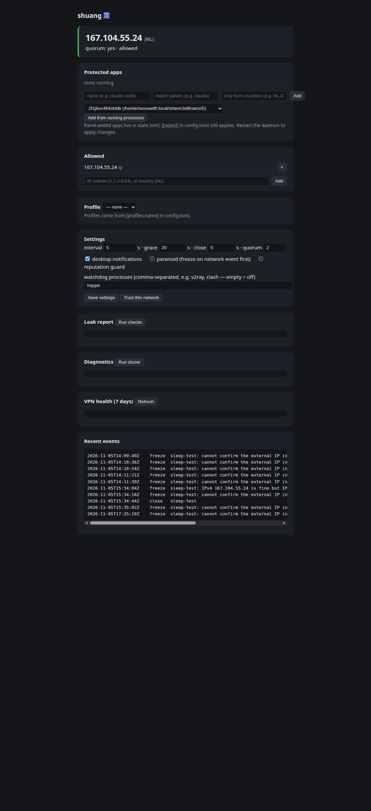

# shuang — 霜 / frost

**[English](README.md)** · [Русский](README.ru.md) · [中文](README.zh.md)

**Freeze your apps when the VPN drops. Suspend, don't kill.**

`shuang` is a free, open-source per-application kill switch. While your
external IP is not on the allowlist, the whole process tree of the chosen
application is **suspended** (`SIGSTOP`) — it runs zero instructions and sends
nothing. When the right IP is back, it resumes exactly where it stopped.
If the IP never comes back within the grace period, the tree is stopped.

Built for AI coding agents (Claude Code, Codex, Gemini CLI) and any app that
must never talk to the network from the wrong address. No server, no account,
no telemetry — a single binary.

## Why

A VPN client's built-in kill switch cuts the whole network. `shuang` works
per-application: the frozen app leaks nothing, everything else keeps working.
And unlike firewall rules, suspension is reversible — a two-second VPN blip
pauses Claude Code and lets it continue from the same place, session intact.

## Install

Linux and macOS today; Windows support (suspend via `NtSuspendProcess`) is
compiled in and being verified in CI.

### One-line (Linux & macOS)

```bash
curl -fsSL https://raw.githubusercontent.com/rasuvaeff/shuang/master/scripts/install.sh | sh
```

The download is verified against the `.sha256` published with the release; a
mismatch aborts the install. Override the location with `INSTALL_DIR=…`, pin a
version with `VERSION=vX.Y.Z`.

### Windows (PowerShell)

```powershell
irm https://raw.githubusercontent.com/rasuvaeff/shuang/master/scripts/install.ps1 | iex
```

Installs into your user profile (no administrator rights) and adds itself to
the user `PATH`. Prebuilt `x86_64-pc-windows-msvc` binaries are on the
[Releases](https://github.com/rasuvaeff/shuang/releases) page; the installer
verifies the published `.sha256` before installing.

### Cargo

```bash
cargo install --git https://github.com/rasuvaeff/shuang
```

## Usage

### Kill switch for one command

```bash
shuang run -- claude -p "fix the tests"
```

- IP not allowed **at start** → the command never runs, exit code **69**;
- IP goes bad **mid-run** → the whole process tree (MCP servers, `curl`,
  `git`, …) is frozen; if the allowed IP returns within the grace period, the
  command continues — otherwise it is stopped, exit code **75**;
- Ctrl+C → everything frozen is **resumed** before shuang exits;
- otherwise the exit code is the command's own.

With an **empty allowlist** the first run remembers the startup addresses as
the allowed ones (freeze on *change*). Add entries with `shuang allow`:

```bash
shuang allow 203.0.113.42      # an IP
shuang allow 185.12.40.0/24    # a subnet
shuang allow NL                # a whole country
shuang deny RU                 # remove an entry (same as the panel's ×)
```

Close a leak where the OS allows it:

```bash
shuang fix disable-ipv6   # the classic "VPN tunnels only IPv4" leak
shuang fix enable-ipv6
shuang fix dns-public     # prints the exact commands (resolv.conf is never
                          # rewritten automatically)
```
Without root the fix prints the exact sudo command instead of failing.

### Daemon: watch apps, with a tray icon

```bash
shuang daemon            # tray icon + desktop notifications
shuang daemon --no-tray --no-notify   # fully headless (servers)
```

The tray shows the status color (green/orange), the IP and country in the
tooltip, the freeze reason and grace countdown in the menu. Quit from the
menu resumes everything. On GNOME the icon needs the AppIndicator extension
(Ubuntu ships it); KDE/XFCE/Cinnamon work natively.

**Notifications are anti-noise by design:** a short blip produces ONE quiet
"VPN blinked for 8s" notification on recovery — not two popups; a freeze
longer than 60s alerts once.

### Run it past the terminal (autostart)

`shuang daemon` runs in the foreground; closing the terminal sends SIGHUP —
handled like Ctrl+C (everything frozen is resumed first). To keep it running
independently of any terminal and start it at login, use a systemd **user**
service:

```ini
# ~/.config/systemd/user/shuang.service
[Unit]
Description=shuang — per-app VPN kill switch daemon
After=network-online.target

[Service]
ExecStart=%h/.local/bin/shuang daemon
Restart=on-failure
RestartSec=3

[Install]
WantedBy=default.target
```

```bash
systemctl --user enable --now shuang   # start now + at every login
systemctl --user restart shuang        # after changing settings
journalctl --user -u shuang -f         # the log, instead of a terminal
```

### One-shot check

```bash
shuang check          # human-readable
shuang check --json   # {"ipv4": "...", "ipv6": "...", "country": "NL", "quorum": true, "allowed": true}
```

Exit codes: `0` allowed, `3` not allowed, `1` error.

### Leak report

```bash
shuang leaks
```

One command shows: what every IP service sees **individually** (disagreement
= a problem), the IPv6 exit, the address and **latency** the AI services' own
edge sees (`/cdn-cgi/trace` of claude.ai, chatgpt.com, … — catches split
routing), the **DNS resolvers** and their countries (a resolver in another
country is a DNS leak), the **exit IP reputation** (residential vs
datacenter, proxy/Tor flags — the "IP purity" risk checks), the local
timezone, the proxy environment, and the gateway MAC for a
`trusted_networks` entry. Also warns when the exit country is not on
Claude's supported list, and when the AI edge sees you over IPv6.

Exit codes: `0` clean, `4` leaks found.

### Web panel



`shuang daemon` serves a local settings panel: it prints a one-time URL
(`http://127.0.0.1:<port>/?token=…`) and the tray menu gets an "Open panel"
item. The panel shows live status (IP, country, quorum, frozen processes),
manages the allowlist (add/remove IPs, subnets, countries), switches profiles,
runs `leaks`/`doctor`/`stats` with one click, offers leak fixes (e.g. disable
IPv6), and edits settings: check interval, grace/close timeouts, quorum,
notifications, and "trust this network" (the gateway MAC). Panel edits are
written to `state.toml` — `config.toml` is never rewritten. The panel binds
127.0.0.1 only and every request must carry the per-run token.

### Diagnostics and history

```bash
shuang doctor    # config, quorum, country, timezone, gateway, D-Bus — exit 4 on problems
shuang events    # freeze/resume/close history (history.log next to the config)
shuang stats     # VPN health: freezes, closes, average freeze duration over 7 days
shuang profile   # list / activate allowlist profiles
```

## Config

`~/.config/shuang/config.toml` — missing file means built-in defaults
(an explicitly passed `--config` that is missing is an error, not defaults).

```toml
[[apps]]
name = "claude-code"
match = ["claude", "args:claude"]   # process name / path substring / args: substring
[apps.allow]                        # optional per-app rules on top of the global ones
countries = ["NL"]                  # Claude only from NL, Cursor may allow more

[[apps]]
name = "cursor"
match = ["cursor", "args:cursor"]

[allow]                             # global allowlist
countries = ["NL"]
nets = ["185.12.40.0/24"]

[ip_check]
interval_secs = 5                   # poll backstop; netlink events react instantly
timeout_secs = 5
min_agree = 2                       # ≥ services must name the same IPv4
ip_services = [...]                 # default: ipify, icanhazip, ident.me, checkip.amazonaws.com
ipv6_services = [...]
country_services = ["https://api.country.is"]

[timing]
grace_secs = 20                     # how long a frozen tree waits for the right IP
freeze_on_event_first = false        # paranoid: freeze on a network event BEFORE re-checking
stability_secs = 0                   # resume only after a good verdict HOLDS this long
close_secs = 5                      # polite stop before a forced kill

[profiles.work]                     # `shuang profile work` activates
countries = ["NL", "DE"]

trusted_networks = ["aa:bb:cc:dd:ee:ff"]   # gateway MACs where protection is off (home/office)

[probe]
enabled = true          # 1-second TCP transport probe (freeze ~instantly on death)
hosts = ["1.1.1.1:80", "9.9.9.9:80"]
distinguish_offline = true   # events say vpn-down vs offline

[watchdog]
processes = ["v2ray", "clash"]  # freeze when the local proxy client dies (empty = off)

[reputation]
enabled = true         # freeze while the exit IP carries a proxy/hosting flag
fail_flags = ["proxy", "hosting"]
every_secs = 60

[route_check]
enabled = true          # freeze when the AI edge sees a foreign address (split routing)
every_secs = 30
```

**Per-app rules** are independent: one app can be frozen while another keeps
running (the panel can set per-app countries when adding an app). **Trusted
networks** are recognized by the router's MAC — at home protection is off, in
a café it is back on (Linux, macOS, Windows).
**Profiles** switch allowlist sets in one command; the selection lives in
`state.toml`, your commented config is never rewritten.

## Reliability model

- **Fail-closed:** an unknown verdict (no quorum, tie, timeouts) is never
  allowed. No exceptions.
- **Instant reaction (Linux):** netlink route/address/link events trigger an
  immediate re-check — no 5s window after a network change.
- **Suspend-aware timing:** the grace timer uses `CLOCK_BOOTTIME`, so a
  laptop sleep does not eat the grace period.
- **Clean exit:** Ctrl+C/SIGTERM resumes everything frozen.
- **Crash recovery:** the frozen pid set is persisted to `state.toml`; the
  next run resumes "frozen orphans" left by a killed shuang.
- **IPv6 leak detection:** a direct IPv6 route the VPN does not tunnel fails
  the verdict.
- **Quorum:** the country is cached per exit subnet (/24), so one flaky
  country-service answer does not re-freeze a confirmed exit.

## What shuang sends over the network

Only the checks you configured (defaults: `api.ipify.org`,
`ipv4.icanhazip.com`, `v4.ident.me`, `checkip.amazonaws.com`, the IPv6
counterparts, `api.country.is`; the leak report also asks `ip-api.com` for
the exit IP's reputation). No telemetry, no update pings, no server of ours.
Point `ip_services` at your own plain-text endpoint if you prefer.

## Exit codes

| Code | Meaning |
|---|---|
| `0` | allowed / success / clean |
| `1` | error (bad config, cannot start the command, …) |
| `3` | `check`: current IP not allowed |
| `4` | `leaks`/`doctor`: problems found |
| `69` | `run`: IP not allowed at start, command never ran |
| `75` | `run`: stopped — the allowed IP never came back |

## Platform support

| Platform | Suspend | Tray | Notes |
|---|---|---|---|
| Linux | ✅ | ✅ (KSNI) | netlink instant reaction, gateway MAC, resolv.conf DNS check |
| macOS | ✅ | ✅ (tray-icon, main-thread loop) | config-poll network events |
| Windows | ✅ (`NtSuspendProcess`) | 🚧 | being verified in CI |
| HarmonyOS PC | 📋 | — | possible later via `aarch64-unknown-linux-ohos` |

## Security notes

- A suspended process sends nothing, but the freeze happens after the network
  change (milliseconds with netlink): for a hard "not a single packet"
  guarantee, combine `shuang` with your VPN client's network-level kill
  switch — this tool complements it, not replaces it.
- Processes running as root/system services are not touched.
- `daemon` matches processes by name — an attacker process named like your
  app is out of scope for v0.1.

## Development

```bash
cargo fmt
cargo clippy --all-targets --locked -- -D warnings
cargo test --all --locked
```

Rust 1.88+ (edition 2024). `Cargo.lock` is committed (binary crate). Tests
never touch the real network — integration tests run against a local mock
HTTP service; the allowlist invariants are covered by property-based tests.

## License

[GPL-3.0-or-later](./COPYING). Forks must stay open.
