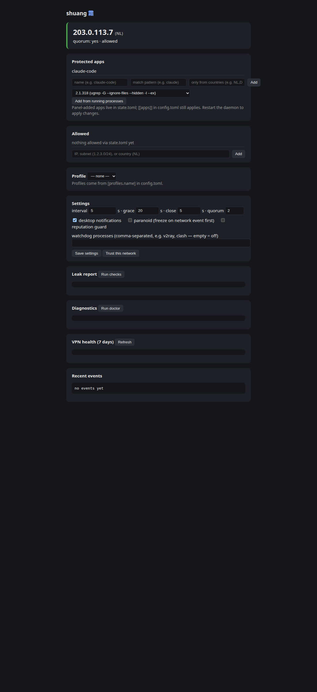

# shuang — 霜 / мороз

**[English](README.md)** · [Русский](README.ru.md)** · [中文](README.zh.md)

**Замораживай приложения, когда падает VPN. Пауза вместо убийства.**

`shuang` — бесплатный open-source kill switch уровня приложения. Пока внешний
IP не в allowlist, всё дерево процессов выбранного приложения **замораживается**
(`SIGSTOP`): не выполняется ни одной инструкции, не отправляется ни одного
байта. Правильный IP вернулся — работа продолжается с того же места. Не
вернулся за grace-период — дерево останавливается.

Создан для ИИ-агентов (Claude Code, Codex, Gemini CLI) и любых программ,
которые не должны ходить в сеть «не с того» адреса. Без сервера, без аккаунта,
без телеметрии — один бинарник.

## Зачем

Kill switch VPN-клиента рубит интернет целиком. `shuang` работает точечно:
замороженное приложение не течёт, всё остальное живёт. И, в отличие от правил
фаервола, заморозка обратима: двухсекундное моргание VPN ставит Claude Code на
паузу и отпускает — сессия и контекст целы.

## Установка

Linux и macOS; Windows (заморозка через `NtSuspendProcess`) — собран и
проверяется в CI.

### Одной строкой (Linux и macOS)

```bash
curl -fsSL https://raw.githubusercontent.com/rasuvaeff/shuang/master/scripts/install.sh | sh
```

Скачивание сверяется с `.sha256` из релиза; несовпадение — отказ установки.
Каталог переопределяется `INSTALL_DIR=…`, версия пинится `VERSION=vX.Y.Z`.

### Windows (PowerShell)

```powershell
irm https://raw.githubusercontent.com/rasuvaeff/shuang/master/scripts/install.ps1 | iex
```

Ставится в профиль пользователя (без прав администратора) и добавляет себя в
`PATH`. Готовые бинарники `x86_64-pc-windows-msvc` — на странице
[Releases](https://github.com/rasuvaeff/shuang/releases); installer перед
установкой сверяет опубликованный `.sha256`.

### Cargo

```bash
cargo install --git https://github.com/rasuvaeff/shuang
```

## Использование

### Kill switch для одной команды

```bash
shuang panel                         # панель настроек в нативном окне
```

- IP не разрешён **при старте** → команда не запускается, код выхода **69**;
- IP испортился **по ходу** → всё дерево процессов (MCP-серверы, `curl`,
  `git`, …) замораживается; вернулся за grace-период — продолжаем, нет —
  остановка, код **75**;
- Ctrl+C → всё замороженное **размораживается** до выхода shuang;
- иначе — код выхода самой команды.

С **пустым allowlist** первый запуск запоминает стартовые адреса как
разрешённые (заморозка «по изменению»). Добавление записей:

```bash
shuang allow 203.0.113.42      # IP
shuang allow 185.12.40.0/24    # подсеть
shuang allow NL                # целая страна
shuang deny RU                 # удалить запись (то же, что × в панели)
```

Закрыть утечку, если ОС позволяет:

```bash
shuang fix disable-ipv6   # классика «VPN заворачивает только IPv4»
shuang fix enable-ipv6
shuang fix dns-public     # печатает точные команды (resolv.conf никогда не
                          # переписывается автоматически)
```
Без прав fix печатает точную sudo-команду вместо ошибки.

### Демон: слежение за приложениями, с иконкой в трее

```bash
shuang daemon                       # трей + системные уведомления
shuang daemon --no-tray --no-notify # полностью headless (серверы)
```

Трей показывает цвет статуса (зелёный/оранжевый), IP и страну в тултипе,
причину заморозки и отсчёт grace в меню. Выход из меню размораживает всё.
В GNOME иконке нужно расширение AppIndicator (в Ubuntu оно есть);
KDE/XFCE/Cinnamon — нативно.

**Уведомления без шума:** короткое моргание даёт ОДНО тихое «VPN мигнул на
8с» при восстановлении, а не два попа; заморозка дольше 60с алертит один раз.

### Работа без терминала (автозапуск)

`shuang daemon` работает в foreground; закрытие терминала шлёт SIGHUP — он
обрабатывается как Ctrl+C (сначала размораживается всё замороженное). Чтобы
демон жил независимо от терминалов и стартовал при входе в систему, нужен
systemd **user**-сервис:

```ini
# ~/.config/systemd/user/shuang.service
[Unit]
Description=shuang — per-app VPN kill switch daemon
After=network-online.target

[Service]
ExecStart=%h/.local/bin/shuang daemon
Restart=on-failure
RestartSec=3

[Install]
WantedBy=default.target
```

```bash
systemctl --user enable --now shuang   # запустить сейчас + при каждом логине
systemctl --user restart shuang        # после смены настроек
journalctl --user -u shuang -f         # лог вместо терминала
```

### Разовая проверка

```bash
shuang check          # по-человечески
shuang check --json   # {"ipv4": "...", "ipv6": "...", "country": "NL", "quorum": true, "allowed": true}
```

Коды выхода: `0` разрешён, `3` не разрешён, `1` ошибка.

### Отчёт об утечках

```bash
shuang leaks
```

Одна команда показывает: что видит **каждый** IP-сервис по отдельности
(расхождение = проблема), IPv6-выход, адрес и **задержку**, которые видит сам
edge ИИ-сервисов (`/cdn-cgi/trace` у claude.ai, chatgpt.com, … — ловит
раздельную маршрутизацию), **DNS-резолверы** и их страны (резолвер в чужой
стране = DNS-утечка), **репутацию выходного IP** (residential против
datacenter, флаги proxy/Tor — те самые «проверки чистоты IP»), локальный
часовой пояс, прокси-окружение и MAC шлюза для `trusted_networks`. Также
предупреждает, если страна выхода не в списке поддерживаемых Claude, и если
edge видит вас по IPv6.

Коды выхода: `0` чисто, `4` найдены проблемы.

### Веб-панель



`shuang daemon` поднимает локальную панель настроек: в stderr печатается
одноразовая ссылка (`http://127.0.0.1:<порт>/?token=…`), а в меню трея
появляется пункт «Open panel». Панель показывает живой статус (IP, страна,
кворум, замороженные процессы), управляет allowlist (добавление/удаление IP,
подсетей, стран), переключает профили, запускает `leaks`/`doctor`/`stats`
одной кнопкой, предлагает закрытие утечек (например, выключить IPv6) и
редактирует настройки: интервал проверок, grace/close-таймауты, кворум,
уведомления и «доверять этой сети» (MAC шлюза). Всё, что меняет панель,
пишется в `state.toml` — `config.toml` не переписывается никогда. Панель
слушает только 127.0.0.1, и каждый запрос обязан нести токен запуска.
Изменения из панели применяются сразу; кнопка «Применить сейчас» перечитывает
правила и после ручного редактирования `config.toml`. Повреждённый `state.toml`
не заменяется пустым состоянием: демон замораживает защищаемые приложения.
Первое приложение можно добавить в панели: для запуска демона `[[apps]]` больше
не обязателен, если панель включена.

### Диагностика и история

```bash
shuang doctor    # конфиг, кворум, страна, часовой пояс, шлюз, D-Bus — exit 4 при проблемах
shuang events    # история заморозок (history.log рядом с конфигом)
shuang stats     # здоровье VPN: заморозки, остановки, средняя длительность за 7 дней
shuang profile   # список / активация профилей allowlist
```

## Конфиг

`~/.config/shuang/config.toml` — отсутствующий файл = встроенные дефолты
(отсутствующий явно переданный `--config` — ошибка, а не дефолты).

```toml
[[apps]]
name = "claude-code"
match = ["claude", "args:claude"]   # имя процесса / подстрока пути / args: подстрока
[apps.allow]                        # опционально: свои правила поверх общих
countries = ["NL"]                  # Claude только из NL, у Cursor может быть шире

[[apps]]
name = "cursor"
match = ["cursor", "args:cursor"]

[allow]                             # общий allowlist
countries = ["NL"]
nets = ["185.12.40.0/24"]

[ip_check]
interval_secs = 5                   # опрос-подстраховка; netlink-события реагируют мгновенно
timeout_secs = 5
min_agree = 2                       # минимум сервисов должны сойтись на одном IPv4
ip_services = [...]                 # дефолт: ipify, icanhazip, ident.me, checkip.amazonaws.com
ipv6_services = [...]
strict_ipv6 = false                 # требовать ответ IPv6, если заданы сервисы
country_services = ["https://api.country.is"]

[timing]
grace_secs = 20                     # сколько замороженное ждёт правильный IP
freeze_on_event_first = false        # паранойя: заморозка при событии сети ДО перепроверки
stability_secs = 0                   # разморозка только после N секунд стабильного вердикта
close_secs = 5                      # дополнительное время заморозки до завершения

[profiles.work]                     # `shuang profile work` активирует
countries = ["NL", "DE"]

trusted_networks = ["aa:bb:cc:dd:ee:ff"]   # MAC роутеров, где защита выключена (дом/офис)

[probe]
enabled = true          # 1-second TCP transport probe (freeze ~instantly on death)
hosts = ["1.1.1.1:80", "9.9.9.9:80"]
distinguish_offline = true   # events say vpn-down vs offline

[watchdog]
processes = ["v2ray", "clash"]  # freeze when the local proxy client dies (empty = off)

[reputation]
enabled = true         # freeze while the exit IP carries a proxy/hosting flag
fail_flags = ["proxy", "hosting"]
every_secs = 60

[route_check]
enabled = true          # диагностический запрос к AI edge; при split routing сам покажет IP
strict = false                      # блокировать, если проверка маршрута не подтвердила выход
every_secs = 30
```

**Правила per-app независимы:** одно приложение заморожено, другое работает
(страны приложения добавляются к общему allowlist, а не сужают его). **Доверительные
сети** узнаются по MAC роутера — дома защита выключена, в кафе снова включена
(Linux, macOS, Windows). **Профили** переключают
наборы allowlist одной командой; выбор хранится в `state.toml`, ваш
комментированный конфиг никогда не переписывается.

У каждого приложения видны решение демона, причина блокировки и оставшееся время до завершения. Панель показывает, сохранены ли правила, проверяются или уже действуют. При добавлении приложения найдите процесс по имени или пути и проверьте совпадения перед сохранением.

## Модель надёжности

Демон реагирует на сбой транспорта даже во время проверки и на Unix подтверждает фактическую остановку процессов. Он повторно ищет дочерние процессы и останавливает те, что возобновились при действующем запрете. Расхождение IPv6 всегда блокирует доступ. Параметры `strict_ipv6` и `route_check.strict` требуют подтверждения от соответствующих проверок.

- **Fail-closed:** неизвестный вердикт (нет кворума, ничья, таймауты) никогда
  не разрешается. Без исключений.
- **Быстрая реакция (Linux):** netlink-события маршрутов/адресов/линков
  запускают перепроверку без ожидания очередного интервала; режим
  `freeze_on_event_first` замораживает приложение до этой перепроверки.
- **Часы, выживающие сон:** grace-таймер использует `CLOCK_BOOTTIME` — сон
  ноутбука не съедает grace-период.
- **Чистый выход:** по Ctrl+C/SIGTERM демон снимает свои заморозки.
  `shuang run` завершает команду и её замороженных потомков.
- **Восстановление после падения:** экземпляры используют общий журнал
  `frozen.toml` (`/tmp/shuang-freeze-<uid>/` на Unix и `%LOCALAPPDATA%/shuang/`
  на Windows). Демон снимает заморозку после падения только при тех же
  правилах приложения и разрешённом вердикте в течение `stability_secs`.
  Заморозки живых экземпляров сохраняются. Старые записи в `state.toml`,
  изменившиеся правила и аварийные сеансы `shuang run` требуют ручной проверки.
- **Применение правил:** кнопка «Применить сейчас» и правки из панели
  прерывают текущую проверку. Включённая проверка маршрута применяется и к
  приложениям, которым доступ разрешён собственными правилами.
- **Детект IPv6-утечки:** IPv6 должен быть разрешён собственным адресом или
  подсетью; страна, определённая для IPv4, не разрешает IPv6.
- **Кворум:** страна кэшируется по подсети выхода (/24) — единственный сбой
  country-сервиса не замораживает подтверждённый выход.

## Что shuang отправляет в сеть

Только настроенные проверки (дефолт: `api.ipify.org`, `ipv4.icanhazip.com`,
`v4.ident.me`, `checkip.amazonaws.com`, IPv6-аналоги, `api.country.is`; отчёт
утечек дополнительно спрашивает `ip-api.com` о репутации IP). Никакой
телеметрии, пингов обновлений и нашего сервера. `ip_services` можно направить
на собственный endpoint, отдающий IP простым текстом.

## Коды выхода

| Код | Значение |
|---|---|
| `0` | разрешено / успех |
| `1` | ошибка (конфиг, не удалось стартовать команду, …) |
| `3` | `check`: текущий IP не разрешён |
| `4` | `leaks`/`doctor`: найдены проблемы |
| `69` | `run`: IP не разрешён при старте, команда не запускалась |
| `75` | `run`: остановлено — разрешённый IP так и не вернулся |

## Поддержка платформ

| Платформа | Заморозка | Трей | Примечания |
|---|---|---|---|
| Linux | ✅ | ✅ (KSNI) | netlink-мгновенная реакция, MAC шлюза, DNS из resolv.conf |
| macOS | ✅ | ✅ (tray-icon, main-thread loop) | события сети через опрос конфигурации |
| Windows | ✅ (`NtSuspendProcess`) | 🚧 | проверяется в CI |
| HarmonyOS PC | 📋 | — | возможен позже через `aarch64-unknown-linux-ohos` |

## Безопасность

- Замороженный процесс ничего не отправляет, но заморозка происходит после
  смены сети (миллисекунды с netlink): для гарантии «ни одного пакета мимо
  VPN» комбинируйте `shuang` с сетевым kill switch VPN-клиента — инструмент
  дополняет его, а не заменяет.
- `route_check` обращается к AI edge и при ошибочном маршруте сам раскрывает
  ему выходной IP. Проверка отключена по умолчанию.
- Процессы рута и системные службы не трогаются.
- `daemon` матчит процессы по имени — процесс злоумышленника с именем вашего
  приложения вне threat model v0.1.

## Разработка

```bash
cargo fmt
cargo clippy --all-targets --locked -- -D warnings
cargo test --all --locked
```

Rust 1.88+ (edition 2024). `Cargo.lock` закоммичен (бинарный crate). Тесты
не ходят в реальную сеть — интеграционные гоняются против локального mock
HTTP-сервера; инварианты allowlist покрыты property-тестами.

## Лицензия

[GPL-3.0-or-later](./COPYING). Форки обязаны оставаться открытыми.
