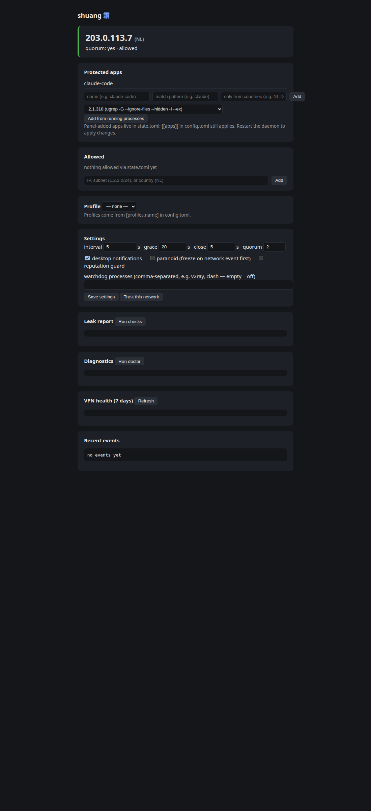

# shuang — 霜

**[English](README.md)** · [Русский](README.ru.md) · **[中文](README.zh.md)**

**VPN 掉线时冻结你的应用 —— 暂停,而不是杀掉。**

`shuang` 是一个免费、开源的按应用 kill switch。当你的外部 IP 不在白名单里时,
所选应用的**整棵进程树会被挂起**(`SIGSTOP`):不执行任何指令、不发送任何数据。
正确的 IP 回来后,它从暂停的地方继续运行。若在宽限期内始终没有回来,进程树将被停止。

为 AI 编程代理(Claude Code、Codex、Gemini CLI)以及任何绝不能以错误地址联网的
应用而生。没有服务器、没有账号、没有遥测 —— 只有一个二进制文件。

## 为什么需要

VPN 客户端自带的 kill switch 会切断整个网络。`shuang` 按应用工作:被冻结的应用
不会泄露任何流量,其他一切照常。与防火墙规则不同,挂起是可逆的 —— VPN 闪断两秒,
Claude Code 暂停后从原处继续,会话完好无损。

## 安装

目前支持 Linux 和 macOS;Windows(通过 `NtSuspendProcess` 挂起)已编译,
正在 CI 中验证。

### 一行命令(Linux 和 macOS)

```bash
curl -fsSL https://raw.githubusercontent.com/rasuvaeff/shuang/master/scripts/install.sh | sh
```

下载会与发布版附带的 `.sha256` 校验;不匹配则拒绝安装。可用 `INSTALL_DIR=…`
覆盖安装目录,用 `VERSION=vX.Y.Z` 固定版本。

### Windows(PowerShell)

```powershell
irm https://raw.githubusercontent.com/rasuvaeff/shuang/master/scripts/install.ps1 | iex
```

安装到用户目录(无需管理员权限)并自动加入用户 `PATH`。预编译的
`x86_64-pc-windows-msvc` 二进制在 [Releases](https://github.com/rasuvaeff/shuang/releases)
页面;安装器安装前会校验发布的 `.sha256`。

### Cargo

```bash
cargo install --git https://github.com/rasuvaeff/shuang
```

## 用法

### 单条命令的 kill switch

```bash
shuang run --tz-from-exit -- claude -p "fix the tests"   # TZ 与出口国一致
```

- **启动时** IP 不允许 → 命令根本不运行,退出码 **69**;
- **运行中** IP 变坏 → 整棵进程树(MCP 服务器、`curl`、`git`……)被冻结;
  宽限期内正确 IP 回来则继续,否则停止,退出码 **75**;
- Ctrl+C → 退出前**恢复**所有被冻结的进程;
- 其他情况退出码为命令自身的退出码。

**白名单为空**时,首次运行会把启动时的地址记为允许(即"变化时冻结")。
添加条目:

```bash
shuang allow 203.0.113.42      # 单个 IP
shuang allow 185.12.40.0/24    # 网段
shuang allow NL                # 整个国家
shuang deny RU                 # 删除条目(同面板的 ×)
```

在系统允许的情况下关闭泄漏:

```bash
shuang fix disable-ipv6   # 经典的「VPN 只隧道 IPv4」泄漏
shuang fix enable-ipv6
shuang fix dns-public     # 打印确切命令(resolv.conf 绝不会被自动改写)
```
没有 root 权限时,fix 会打印确切的 sudo 命令而不是报错。

### 守护进程:监控应用,带托盘图标

```bash
shuang daemon                       # 托盘图标 + 桌面通知
shuang daemon --no-tray --no-notify # 完全无界面(服务器)
```

托盘显示状态颜色(绿/橙),工具提示里是 IP 和国家,菜单里是冻结原因和宽限倒计时。
从菜单退出会恢复所有被冻结的进程。GNOME 需要 AppIndicator 扩展(Ubuntu 自带);
KDE/XFCE/Cinnamon 原生支持。

**通知默认防打扰:**短暂的闪断在恢复时只产生一条安静的通知
「VPN 闪断了 8 秒」,而不是两个弹窗;冻结超过 60 秒只提醒一次。

### 脱离终端运行(开机自启)

`shuang daemon` 在前台运行;关闭终端会发送 SIGHUP —— 其处理方式与
Ctrl+C 相同(先恢复所有被冻结的进程)。要让守护进程独立于终端运行并在
登录时自启,使用 systemd **用户级**服务:

```ini
# ~/.config/systemd/user/shuang.service
[Unit]
Description=shuang — per-app VPN kill switch daemon
After=network-online.target

[Service]
ExecStart=%h/.local/bin/shuang daemon
Restart=on-failure
RestartSec=3

[Install]
WantedBy=default.target
```

```bash
systemctl --user enable --now shuang   # 立即启动 + 每次登录自启
systemctl --user restart shuang        # 修改设置后重启
journalctl --user -u shuang -f         # 查看日志(代替终端)
```

### 一次性检查

```bash
shuang check          # 人类可读
shuang check --json   # {"ipv4": "...", "ipv6": "...", "country": "NL", "quorum": true, "allowed": true}
```

退出码:`0` 允许,`3` 不允许,`1` 错误。

### 泄漏报告

```bash
shuang leaks
```

一条命令展示:**每个** IP 服务各自看到什么(不一致 = 问题)、IPv6 出口、
AI 服务自己的边缘看到的地址和**延迟**(claude.ai、chatgpt.com 的
`/cdn-cgi/trace` —— 抓住分流路由)、**DNS 解析器**及其国家(解析器在别的
国家 = DNS 泄漏)、**出口 IP 信誉**(住宅还是机房、proxy/Tor 标志 —— 就是
「IP 纯净度」检测)、本地时区、代理环境、以及用于 `trusted_networks` 的网关
MAC。出口国家不在 Claude 支持列表、以及边缘通过 IPv6 看到你时,也会警告。

退出码:`0` 干净,`4` 发现问题。

### 网页面板



`shuang daemon` 会启动一个本地设置面板:stderr 中打印一次性链接
(`http://127.0.0.1:<端口>/?token=…`),托盘菜单中出现「Open panel」项。
面板显示实时状态(IP、国家、仲裁、被冻结的进程)、管理白名单(增删 IP、
网段、国家)、切换配置档、一键运行 `leaks`/`doctor`/`stats`、提供泄漏
修复(例如关闭 IPv6),并可编辑设置:检查间隔、宽限/停止超时、仲裁、
通知,以及「信任当前网络」(网关 MAC)。面板的所有修改都写入
`state.toml` —— `config.toml` 永远不会被改写。面板只监听 127.0.0.1,
每个请求必须携带本次运行的令牌。

### 诊断与历史

```bash
shuang doctor    # 配置、仲裁、国家、时区、网关、D-Bus —— 有问题时 exit 4
shuang events    # 冻结/恢复/停止历史(history.log,在配置旁边)
shuang stats     # VPN 健康:一周内的冻结次数、停止次数、平均冻结时长
shuang profile   # 列出 / 激活白名单配置档
```

## 配置

`~/.config/shuang/config.toml` —— 文件不存在时使用内置默认值(显式传入的
`--config` 不存在则是错误,而不是静默用默认值)。

```toml
[[apps]]
name = "claude-code"
match = ["claude", "args:claude"]   # 进程名 / 路径子串 / args: 参数子串
[apps.allow]                        # 可选:在全局规则之上叠加本应用自己的规则
countries = ["NL"]                  # Claude 只允许 NL,Cursor 可以更宽

[[apps]]
name = "cursor"
match = ["cursor", "args:cursor"]

[allow]                             # 全局白名单
countries = ["NL"]
nets = ["185.12.40.0/24"]

[ip_check]
interval_secs = 5                   # 轮询兜底;netlink 事件即时响应
timeout_secs = 5
min_agree = 2                       # 至少 2 个服务给出相同 IPv4
ip_services = [...]                 # 默认:ipify、icanhazip、ident.me、checkip.amazonaws.com
ipv6_services = [...]
country_services = ["https://api.country.is"]

[timing]
grace_secs = 20                     # 冻结后等待正确 IP 的时间
freeze_on_event_first = false        # 偏执模式:网络事件先冻结、再复查
stability_secs = 0                   # 仅在判定稳定 N 秒后才恢复
close_secs = 5                      # 强制杀死前的优雅停止时间

[profiles.work]                     # `shuang profile work` 激活
countries = ["NL", "DE"]

trusted_networks = ["aa:bb:cc:dd:ee:ff"]   # 关闭保护的路由器 MAC(家/办公室)

[probe]
enabled = true          # 1-second TCP transport probe (freeze ~instantly on death)
hosts = ["1.1.1.1:80", "9.9.9.9:80"]
distinguish_offline = true   # events say vpn-down vs offline

[watchdog]
processes = ["v2ray", "clash"]  # freeze when the local proxy client dies (empty = off)

[reputation]
enabled = true         # freeze while the exit IP carries a proxy/hosting flag
fail_flags = ["proxy", "hosting"]
every_secs = 60

[route_check]
enabled = true          # freeze when the AI edge sees a foreign address (split routing)
every_secs = 30
```

**按应用的规则相互独立**:一个应用被冻结时另一个可以继续运行(在面板
中添加应用时可设置仅限国家)。**可信网络**通过路由器 MAC 识别 —— 在家
关闭保护,到咖啡馆自动恢复(Linux、macOS、Windows)。**配置档**一条命令切换白名单集合;选择保存在
`state.toml` 里,你带注释的配置文件永远不会被改写。

## 可靠性模型

- **Fail-closed:**未知的判定(无仲裁、平票、超时)永远不会被允许。没有例外。
- **即时响应(Linux):**netlink 路由/地址/链路事件触发立即复查 —— 网络变化
  后不存在 5 秒窗口。
- **感知休眠的计时:**宽限计时器使用 `CLOCK_BOOTTIME`,合盖睡眠不会吃掉宽限期。
- **干净退出:**Ctrl+C/SIGTERM 恢复所有被冻结的进程。
- **崩溃恢复:**被冻结的 pid 集合持久化到 `state.toml`;下一次运行会恢复被
  杀死的 shuang 留下的「冻结孤儿」。
- **IPv6 泄漏检测:**VPN 未隧道的 IPv6 直连路由会使判定失败。
- **仲裁:**国家按出口网段(/24)缓存,单个 country 服务的一次抖动不会
  重新冻结已确认的出口。

## shuang 会向网络发送什么

只有你配置的检查(默认:`api.ipify.org`、`ipv4.icanhazip.com`、
`v4.ident.me`、`checkip.amazonaws.com` 及 IPv6 对应服务、`api.country.is`;
泄漏报告额外向 `ip-api.com` 查询出口 IP 信誉)。没有遥测、没有更新探测、
没有我们的服务器。可以把 `ip_services` 指向你自己的纯文本端点。

## 退出码

| 码 | 含义 |
|---|---|
| `0` | 允许 / 成功 |
| `1` | 错误(配置错误、无法启动命令……) |
| `3` | `check`:当前 IP 不允许 |
| `4` | `leaks`/`doctor`:发现问题 |
| `69` | `run`:启动时 IP 不允许,命令未运行 |
| `75` | `run`:已停止 —— 允许的 IP 始终没有回来 |

## 平台支持

| 平台 | 挂起 | 托盘 | 说明 |
|---|---|---|---|
| Linux | ✅ | ✅(KSNI) | netlink 即时响应、网关 MAC、resolv.conf DNS 检查 |
| macOS | ✅ | ✅(tray-icon,主线程循环)| 网络事件通过配置轮询 |
| Windows | ✅(`NtSuspendProcess`) | 🚧 | CI 中验证 |
| HarmonyOS PC | 📋 | — | 之后可通过 `aarch64-unknown-linux-ohos` 支持 |

## 安全说明

- 被挂起的进程不发送任何数据,但挂起发生在网络变化之后(有 netlink 时是
  毫秒级):要获得「一个包都不漏」的硬保证,请把 `shuang` 与 VPN 客户端
  网络层的 kill switch 结合使用 —— 本工具是补充,不是替代。
- root / 系统服务的进程不会被触碰。
- `daemon` 按名称匹配进程 —— 攻击者进程伪装成你的应用不在 v0.1 的威胁模型内。

## 开发

```bash
cargo fmt
cargo clippy --all-targets --locked -- -D warnings
cargo test --all --locked
```

Rust 1.88+(edition 2024)。`Cargo.lock` 已提交(二进制 crate)。测试不访问
真实网络 —— 集成测试针对本地 mock HTTP 服务运行;白名单不变量由 property
测试覆盖。

## 许可证

[GPL-3.0-or-later](./COPYING)。分支必须保持开源。
